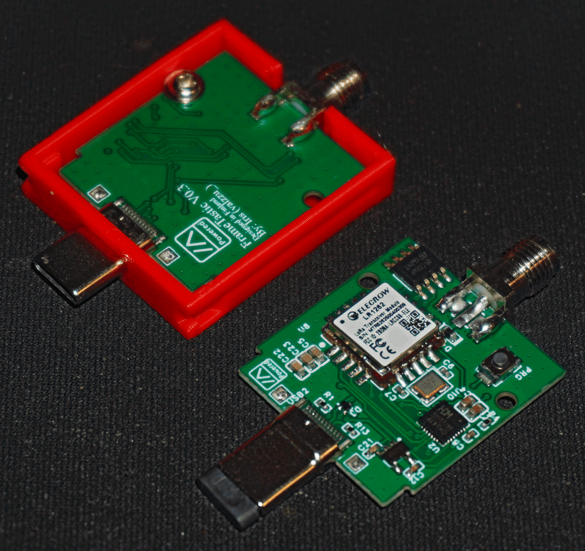
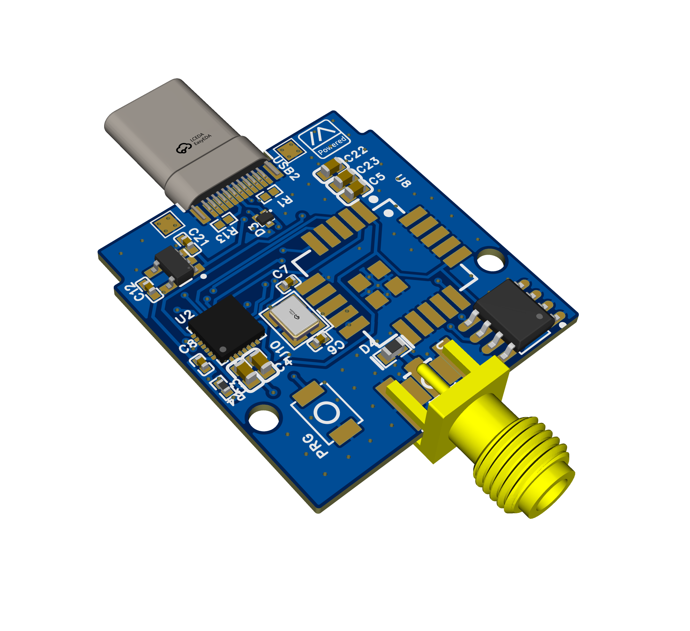
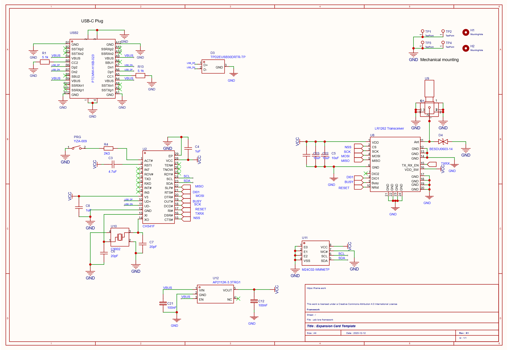

# Licence 

This work is licensed under the [Creative Commons Attribution-NonCommercial-NoDerivatives 4.0 International License (CC BY-NC-ND 4.0)](https://creativecommons.org/licenses/by-nc-nd/4.0/).

### Usage Terms

The license terms are negotiable. You are free to use this work for non-commercial purposes without profit. If you receive compensation or profit from its use, please consider supporting me through [GitHub Sponsors](https://github.com/sponsors/valzzu).

# FrameTastic

> [!WARNING]
> New version has been tested to be funcional.
>
> Only the Elecrow version has been tested but the seed one should work also.

To flash the eeprom u will need to download (ch341eeprom)[https://github.com/meshtastic/ch341eeprom] (Not needed if u buy from me :))

- extract the zip and open the folder
- open termninal in the folder
- plug the module into usb c port while holding PRG button, u can let go after its plugged in
- run
#
    python ch341_factory.py --serial xxxxxxxx --product "FrameTastic 1262" 
- replace x's with 8 digit serial code, for example order number + date and year if it fits

[case]("./FrameTastic case.stl")

